# Nameštanje projekta u Eclipse-u

Kodovi sa predavanja i vežbi su u git repozitorijumu [github.com/marsavic/RG1-2026-2027-1](https://github.com/marsavic/RG1-2026-2027-1). Ovo uputstvo pokazuje kako da ga u Eclipse-u preuzmete, namestite, pokrenete prvi program i posle svakog časa preuzmete nove kodove, sve iz samog IDE-a.

Uputstvo za IntelliJ IDEA je [ovde](IntelliJ.md).

## Pre početka

- **Eclipse IDE for Java Developers**, verzija 2026-03 ili novija (starije ne podržavaju Javu 25): [eclipse.org/downloads](https://www.eclipse.org/downloads/). Podrška za git je već ugrađena, ne morate posebno da instalirate git.
- **BellSoft Liberica JDK 25 (Full)**: [bell-sw.com/pages/downloads](https://bell-sw.com/pages/downloads/). Izaberite vaš operativni sistem, verziju 25 i paket **Full JDK**: samo on sadrži JavaFX. Eclipse ne ume sam da preuzme JDK, pa ga instalirajte unapred.

Ako Eclipse ponudi *Install Java 27 Support* ili slično, to vam nije potrebno, kliknite *Remind Me Later*.

## 1. JDK sa JavaFX-om

1. Otvorite *Window > Preferences* i u polje za pretragu upišite `Installed JREs`.
2. Kliknite **Add…** > **Standard VM** > **Next**.
3. U polje **JRE home** upišite (ili izaberite dugmetom *Directory…*) folder u koji ste instalirali Liberica JDK, npr. `C:\Program Files\BellSoft\LibericaJDK-25-Full` na Windows-u. Kliknite **Finish**.

   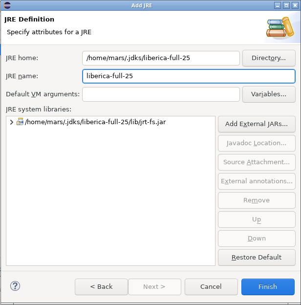

4. Štiklirajte novi JDK, da bi ga koristili svi novi projekti, i kliknite **Apply and Close**.

   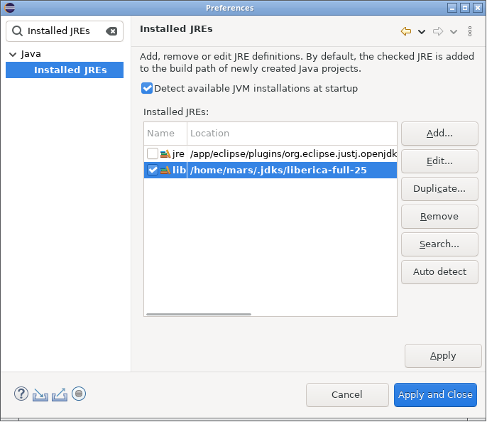

## 2. Preuzimanje repozitorijuma

1. *File > Import…* > **Git** > **Projects from Git (with smart import)** > **Next**.

   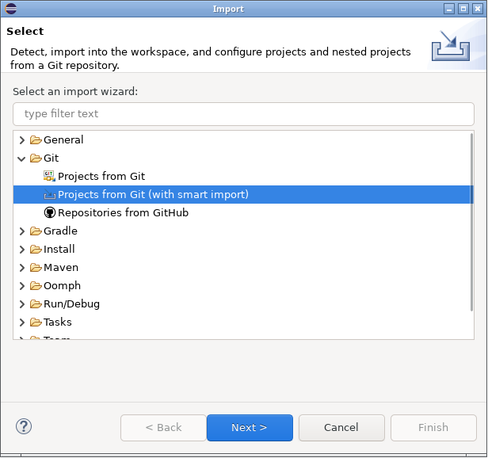

2. Izaberite **Clone URI** > **Next**.
3. U polje **URI** upišite `https://github.com/marsavic/RG1-2026-2027-1` (ostala polja se popune sama) i kliknite **Next**.

   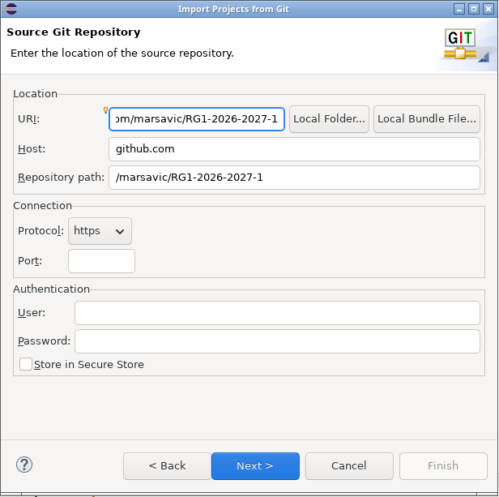

4. Na stranici *Branch Selection* ostavite `master` i kliknite **Next**.
5. Po želji promenite folder u koji će se repozitorijum preuzeti (**Directory**) i kliknite **Next**.

   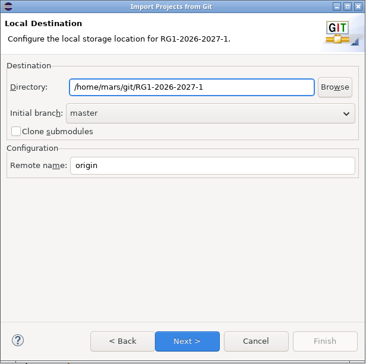

6. Eclipse pronalazi projekat. Kliknite **Finish**.

   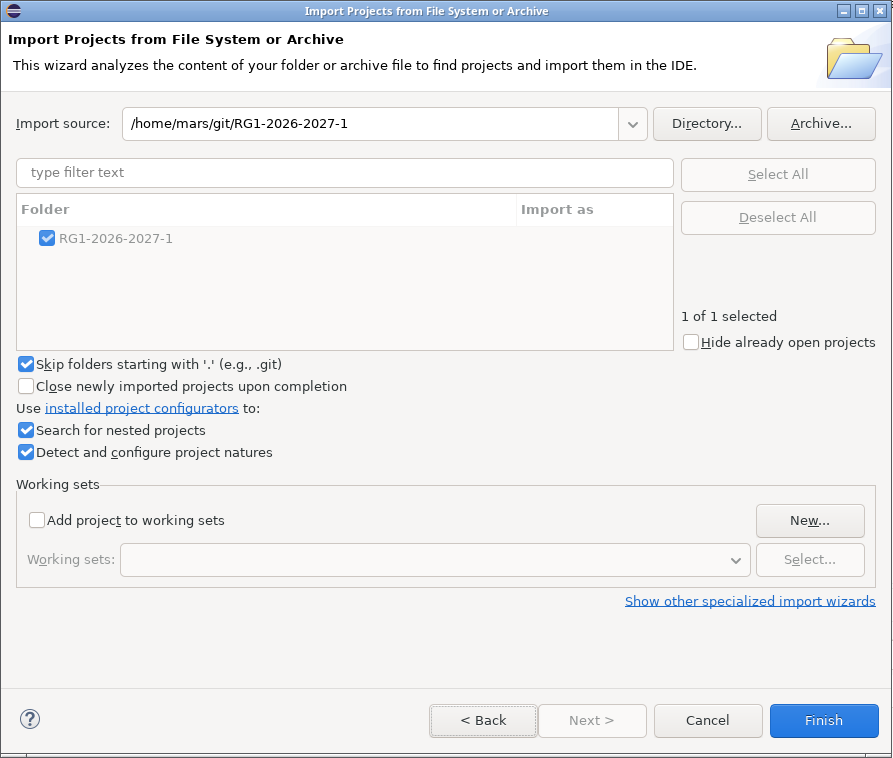

Eclipse sam prepoznaje da je ovo Java projekat, sa izvornim kodom u `src` i bibliotekama iz `lib`, pa ništa ne treba dodatno podešavati. Projekat treba da izgleda ovako, bez grešaka u *Problems*:

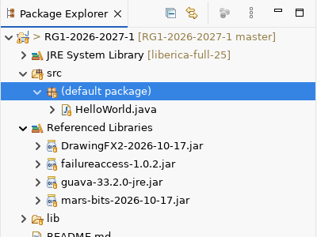

Eclipse u folderu projekta pravi svoje fajlove (`.project`, `.classpath`, `bin`, `.gitignore`). Oni ne idu u git, ne obraćajte pažnju na njih.

## 3. Pokretanje programa HelloWorld

Otvorite `HelloWorld.java` (dvoklik) i izaberite *Run > Run As > Java Application* (ili desni klik na fajl > *Run As > Java Application*). Isto važi za svaki primer sa časa: svaki je klasa sa `main` metodom.

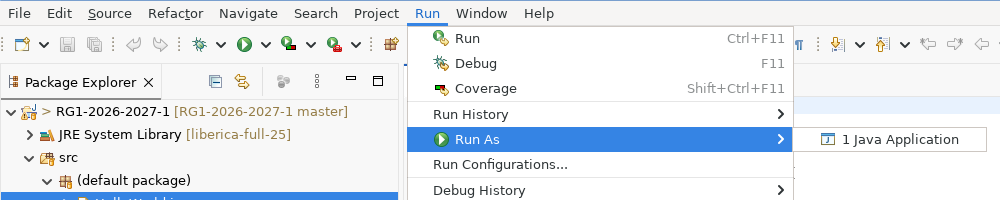

Treba da se otvori prozor sa animiranim natpisom. Levo su kontrole kojima možete menjati vrednosti dok program radi.

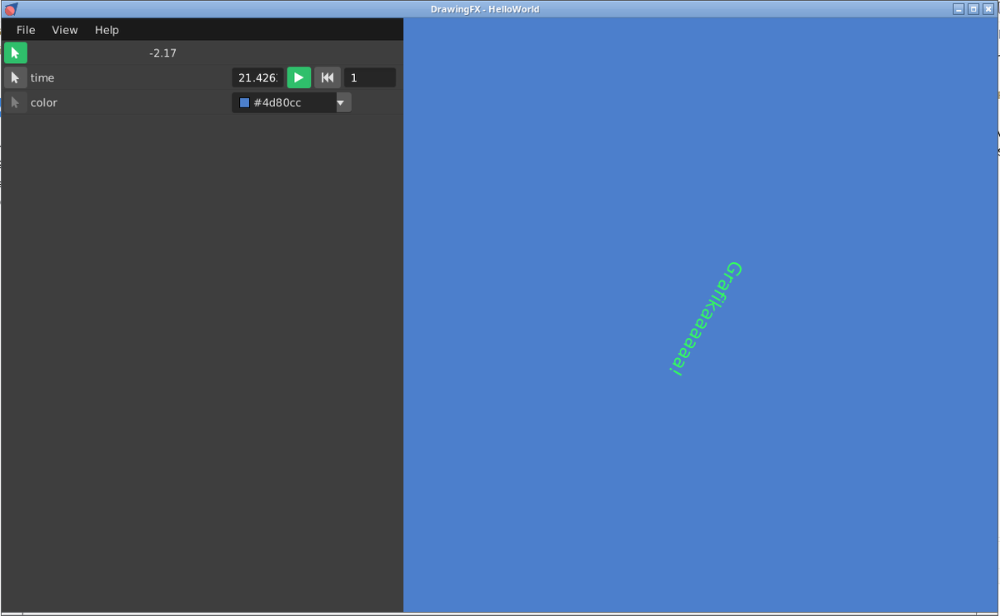

## 4. Preuzimanje novih kodova posle svakog časa

Posle svakog časa u repozitorijumu će biti novi kodovi. Preuzimate ih ovako: desni klik na projekat > **Team** > **Pull**.

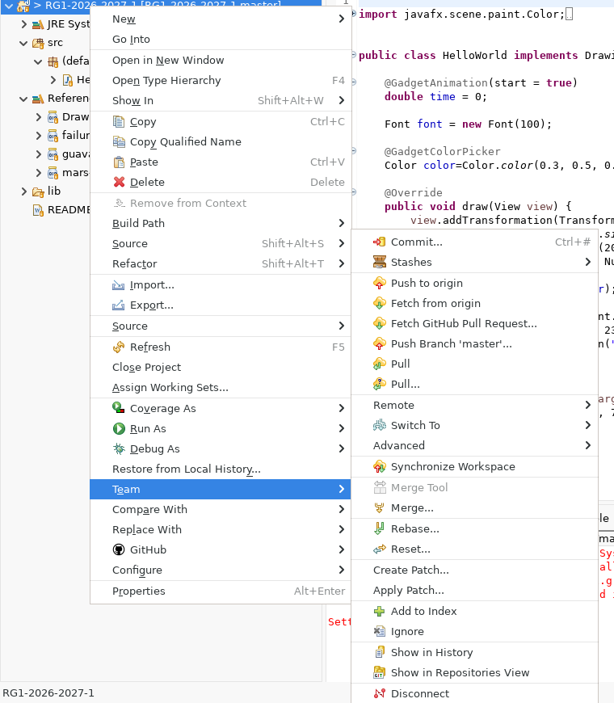

Eclipse prikazuje šta je preuzeto. Ako nema ničeg novog, piše *everything up to date*.

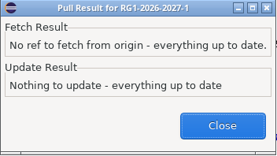

Ako ste menjali fajlove sa časa, Pull može da javi grešku. Tada prvo sklonite svoje izmene: *Team > Stashes > Stash Changes…*, pa ponovite Pull. Svoje izmene kasnije možete vratiti iz *Team > Stashes*. To je najlakše izbeći tako što svoje eksperimente radite u kopijama fajlova (npr. `HelloWorldMoj.java`). Da biste odbacili svoje izmene nekog fajla: desni klik na fajl > *Replace With > HEAD Revision*.

## Česti problemi

- **`The import javafx cannot be resolved`** ili **`JavaFX runtime components are missing`**: projekat ne koristi JDK sa JavaFX-om. Proverite korak 1 i da li u projektu piše *JRE System Library [liberica-…]*.
- **Ctrl+klik na klasu iz biblioteke prikazuje *Source not found***: kliknite *Attach Source…* > *Workspace location* i izaberite isti JAR fajl iz `lib`. JAR fajlovi DrawingFX2 i mars-bits sadrže i izvorni kod sa dokumentacijom.
- **Crveni `WARNING: A restricted method in java.lang.System has been called…` u konzoli**: bezopasno upozorenje JavaFX-a. Da ga uklonite: u *Installed JREs* izaberite Liberica JDK > *Edit…* i u **Default VM arguments** upišite `--enable-native-access=javafx.graphics`.
- **Animacije seckaju** (dešava se npr. na Linux-u sa integrisanim GPU-om): u istom polju dodajte `-Dprism.forceGPU=true`.
