# Nameštanje projekta u IntelliJ IDEA

Kodovi sa predavanja i vežbi su u git repozitorijumu [github.com/marsavic/RG1-2026-2027-1](https://github.com/marsavic/RG1-2026-2027-1). Ovo uputstvo pokazuje kako da ga u IntelliJ IDEA preuzmete, namestite, pokrenete prvi program i posle svakog časa preuzmete nove kodove, sve iz samog IDE-a.

Uputstvo za Eclipse je [ovde](Eclipse.md).

## Pre početka

- **IntelliJ IDEA** (besplatna verzija je dovoljna): [jetbrains.com/idea/download](https://www.jetbrains.com/idea/download/).
- **Git**: [git-scm.com/downloads](https://git-scm.com/downloads). Ako ga nemate, IntelliJ će pri kloniranju ponuditi da ga sam preuzme.
- **JDK** ne morate unapred da instalirate: IntelliJ će ga preuzeti u koraku 2.

## 1. Preuzimanje repozitorijuma

1. Na početnom ekranu IntelliJ-a izaberite **Clone Repository**. (Ako je već otvoren neki projekat: *File > New > Project from Version Control…*)

   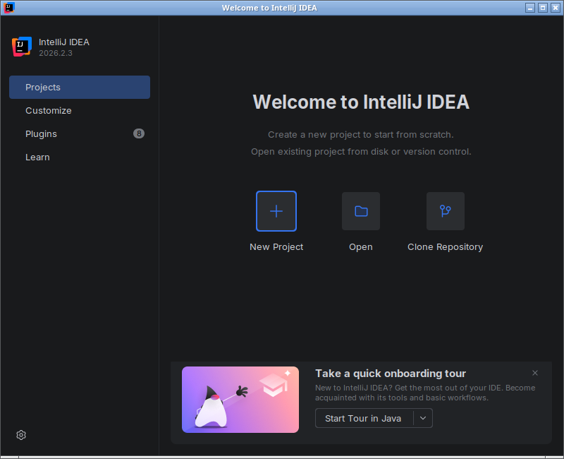

2. U polje **URL** upišite `https://github.com/marsavic/RG1-2026-2027-1`, po želji promenite folder (**Directory**) i kliknite **Clone**.

   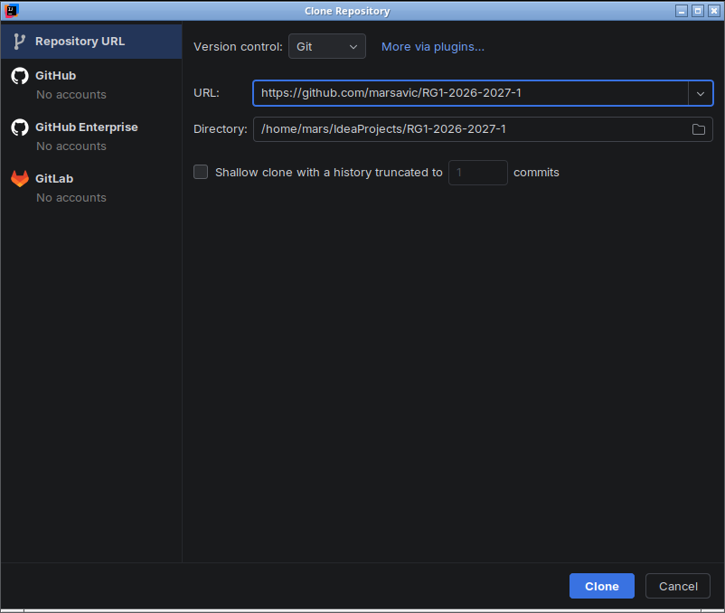

3. Kada vas IntelliJ pita da li verujete projektu, izaberite **Trust Project**.

   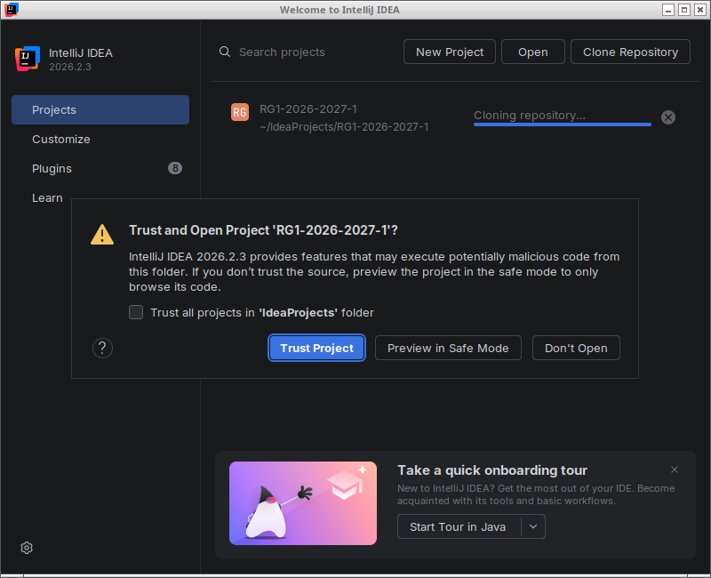

4. Projekat se otvara. Ako se dole desno pojavi poruka *IDE project settings can be added to Git*, kliknite **Don't Ask Again**: podešavanja IDE-a ne treba da idu u git.

   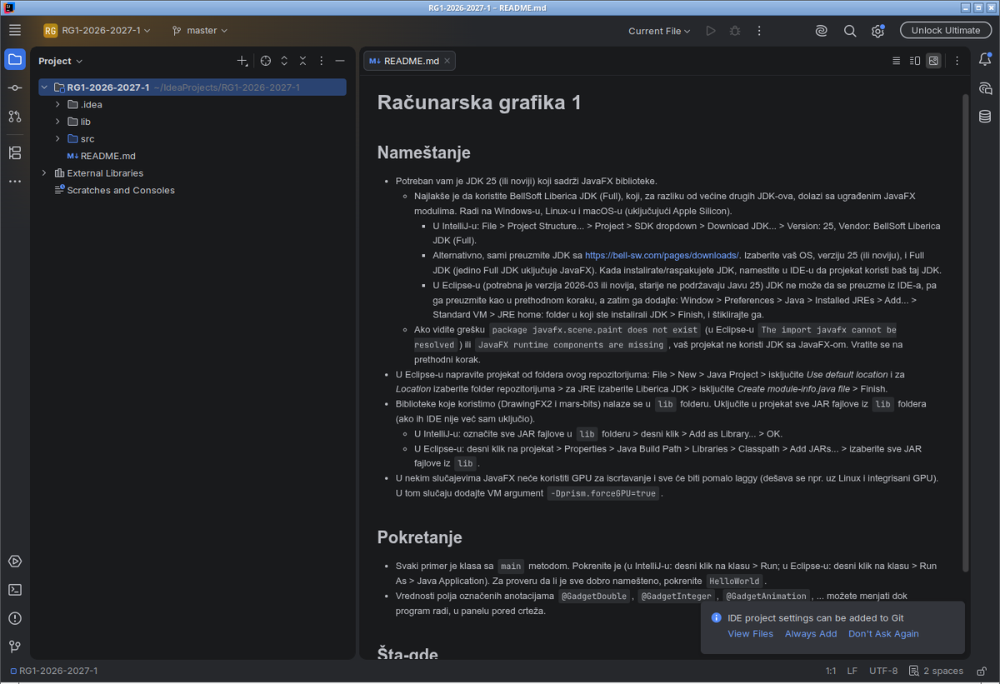

## 2. JDK sa JavaFX-om

Potreban je JDK 25 (ili noviji) koji sadrži JavaFX. Najlakše je koristiti **BellSoft Liberica JDK (Full)**: za razliku od većine drugih JDK-ova, on dolazi sa JavaFX-om.

1. Otvorite *File > Project Structure…* (Ctrl+Alt+Shift+S) > **Project**. U padajućoj listi **SDK** izaberite **Download JDK…**

   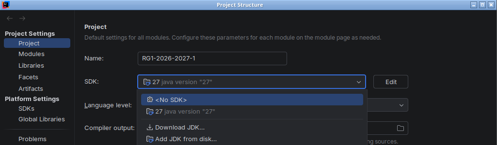

2. Izaberite **Version: 25** i **Vendor: BellSoft Liberica JDK (Full)**, pa kliknite **Download**. Pazite da piše *(Full)*: samo ta verzija sadrži JavaFX.

   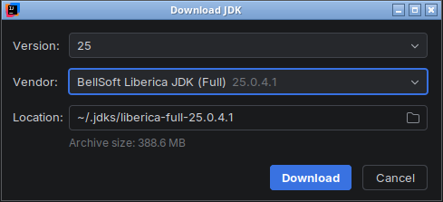

3. Za **Language level** izaberite **SDK default**.

   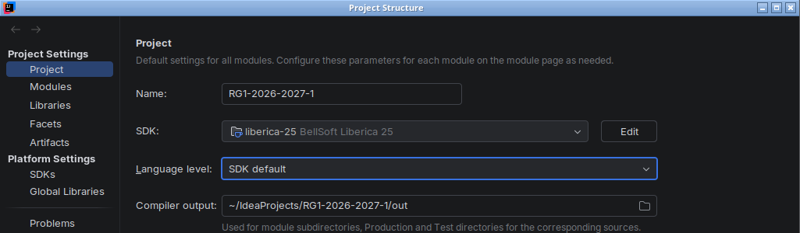

Ako već imate instaliran Liberica JDK 25 (Full), umesto preuzimanja ga izaberite iz liste.

## 3. Biblioteke

Biblioteke koje koristimo (DrawingFX2 i mars-bits) su JAR fajlovi u folderu `lib`. IntelliJ obično sam napravi biblioteku `lib` sa svim JAR fajlovima. To možete proveriti u istom prozoru, na stranici **Libraries**:

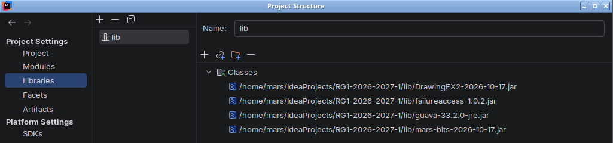

Ako biblioteke nema, kliknite **+** (gore levo) > **Java** i izaberite sve JAR fajlove iz `lib`.

JAR fajlovi DrawingFX2 i mars-bits sadrže i izvorni kod sa dokumentacijom. Da bi ga IntelliJ prikazivao (dokumentacija na hover i Ctrl+klik na ime klase ili metode):

1. Na stranici **Libraries**, izaberite biblioteku `lib` i kliknite **+** iznad liste *Classes*.
2. Izaberite `DrawingFX2-….jar` i `mars-bits-….jar` (Ctrl+klik za više fajlova) i kliknite **OK**.
3. Kada IntelliJ pita šta fajlovi sadrže, izaberite **Sources**.

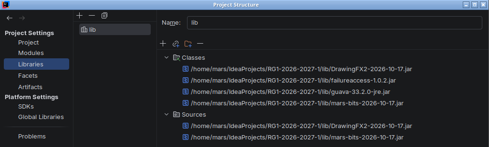

Kliknite **OK** da zatvorite *Project Structure*.

## 4. Pokretanje programa HelloWorld

Otvorite `src/HelloWorld` i kliknite zelenu strelicu levo od `public class HelloWorld`, pa **Run 'HelloWorld.main()'**. Isto važi za svaki primer sa časa: svaki je klasa sa `main` metodom.

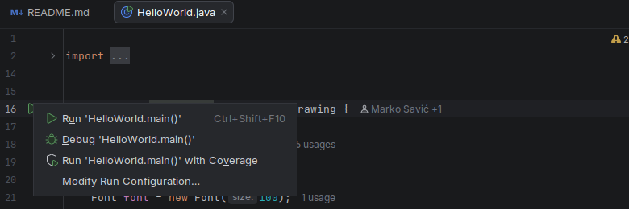

Treba da se otvori prozor sa animiranim natpisom. Levo su kontrole kojima možete menjati vrednosti dok program radi.

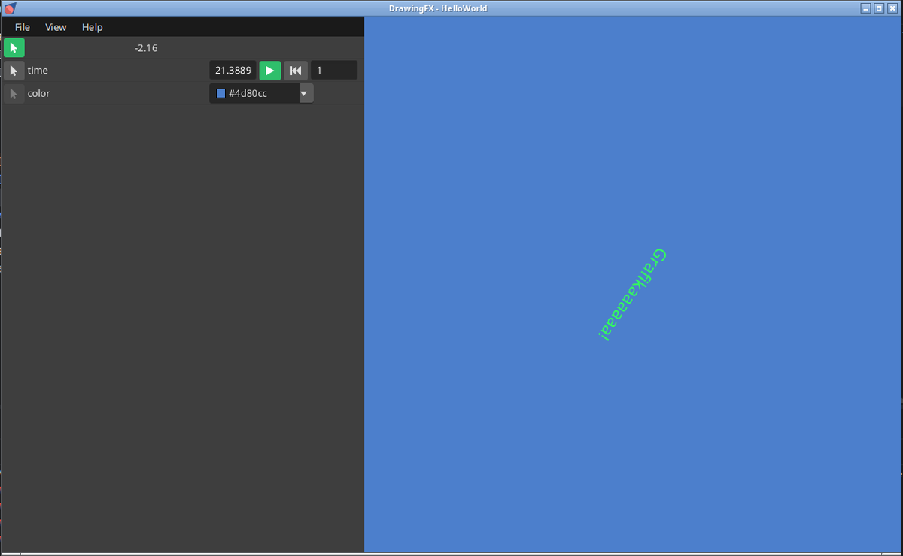

## 5. Preuzimanje novih kodova posle svakog časa

Posle svakog časa u repozitorijumu će biti novi kodovi. Preuzimate ih ovako:

1. *Git > Update Project…* (Ctrl+T).

   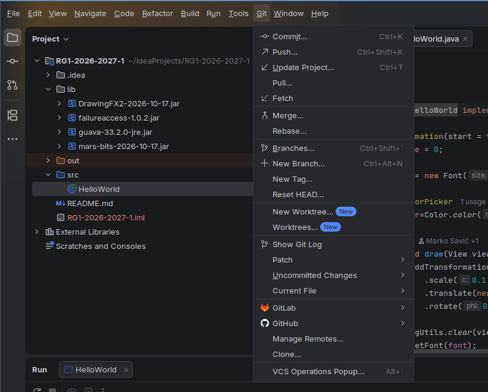

2. Ostavite **Merge incoming changes into the current branch** i kliknite **OK**.

   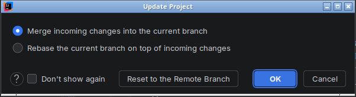

Ako nema ničeg novog, IntelliJ javlja *All files are up to date*.

Ako ste menjali fajlove sa časa, IntelliJ će vaše izmene privremeno skloniti, preuzeti nove kodove i vratiti vaše izmene. Ako ste menjali isti deo koda kao i novi kod, otvoriće se prozor za razrešavanje konflikta. To je najlakše izbeći tako što svoje eksperimente radite u kopijama fajlova (npr. `HelloWorldMoj.java`). Da biste odbacili svoje izmene nekog fajla: desni klik na fajl > *Git > Rollback…*

## Česti problemi

- **`package javafx.scene.paint does not exist`** ili **`JavaFX runtime components are missing`**: projekat ne koristi JDK sa JavaFX-om. Vratite se na korak 2 i izaberite *BellSoft Liberica JDK (Full)*.
- **Crveni `WARNING: A restricted method in java.lang.System has been called…` u konzoli**: bezopasno upozorenje JavaFX-a. Da ga uklonite: *Run > Edit Configurations… > Edit configuration templates… > Application > Modify options > Add VM options* i upišite `--enable-native-access=javafx.graphics` (važi za konfiguracije napravljene posle toga).
- **Animacije seckaju** (dešava se npr. na Linux-u sa integrisanim GPU-om): dodajte VM argument `-Dprism.forceGPU=true` na isti način.
